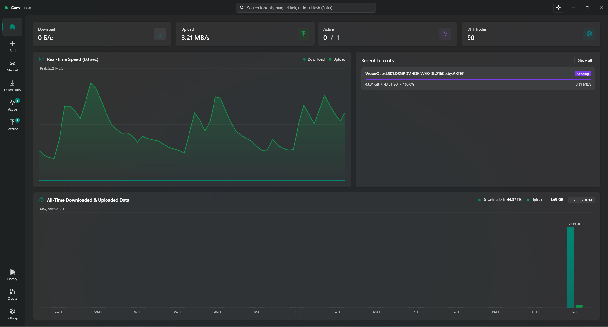
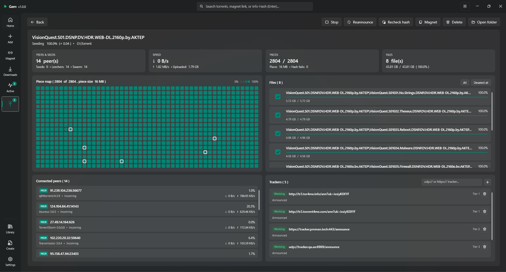
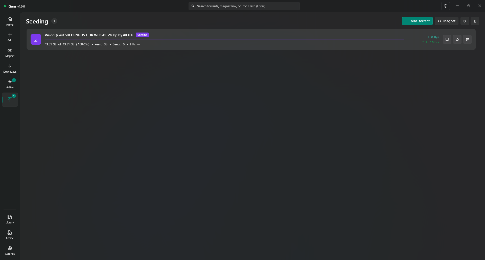

<div align="center">
  
  <h1>Gem</h1>
  <p>Modern Windows BitTorrent client built with <b>.NET 10 (WPF + WPF-UI)</b> and a custom <b>libtorrent-rasterbar 1.2.20</b> native bridge (<code>tsw.dll</code>) featuring classic OS-cached disk I/O, uTP/TCP transport, DHT, LSD, UPnP/NAT-PMP, and installer + portable distribution.</p>
</div>

## Screenshots

**Home Dashboard** — real-time speed graph, recent torrents, and all-time daily traffic chart:



**Torrent Details** — interactive piece map with live uploading piece highlights, file priorities, peers (`progress_ppm`), and trackers:



**Torrents & Seeding List** — distinct visual state for seeding vs downloading torrents:



## Features

- **libtorrent 1.2.20 Engine (`native/tsw`):**
  - Dual uTP + TCP transport, DHT, Local Peer Discovery (LSD), UPnP / NAT-PMP port mapping
  - Sequential piece hash checking queue, selective file priorities (`DoNotDownload`, `Low`, `Normal`, `High`), magnet link & Info-Hash support, `.torrent` release creator
  - Fast resume & session state persistence under `%LOCALAPPDATA%\Gem`
- **Fluent Windows 11 UI:**
  - Light / Dark / System theme support with Mica backdrop and fixed brand accent (`#018574`)
  - Distinct visual states across torrent cards (purple `#7C3AED` for seeding torrents, `#018574` for active downloads)
  - Real-time speed graph (60 s), all-time daily traffic history chart, interactive piece map with live uploading piece highlights, and accurate per-peer swarm progress (`progress_ppm`)
  - Minimize-to-tray background operation, single-instance forwarding for `.torrent` files and `magnet:` links, and built-in GitHub Releases self-updater (`kAdimiron/gem`)
- **86 Windows Display Languages:**
  - Auto-detects the OS UI language on first launch (`LocalizationService.DetectSystemLanguageCode`)
  - Supports live switching across all 86 built-in locale dictionaries in Settings without restarting

## Project Structure

- [src/Gem](src/Gem) — Main WPF desktop application (`net10.0-windows`)
- [tests/Gem.Tests](tests/Gem.Tests) — Unit and integration tests (xUnit)
- [installer](installer) — Inno Setup 6 installer script ([Gem.iss](installer/Gem.iss)) registering `.torrent` file & `magnet:` URL associations
- [native/tsw](native/tsw) — C++17 C-ABI bridge (`tsw.dll`) linking statically against `libtorrent-rasterbar 1.2.20`, Boost, and OpenSSL
- [native/win-x64/tsw.dll](native/win-x64/tsw.dll) — Prebuilt x64 native library copied automatically during build & publish

## Requirements & Build

- [.NET 10 SDK](https://dotnet.microsoft.com/download) on Windows (x64)

Run all tests:

```powershell
dotnet test Gem.slnx -c Release
```

Build Debug:

```powershell
dotnet build src/Gem/Gem.csproj -c Debug
```

Publish a single-file self-contained `Gem.exe` (no .NET runtime installation required for end users):

```powershell
dotnet publish src/Gem/Gem.csproj -c Release -r win-x64 --self-contained true -p:PublishSingleFile=true -p:IncludeNativeLibrariesForSelfExtract=true -p:EnableCompressionInSingleFile=true -p:DebugType=None -p:DebugSymbols=false -o publish/win-x64
```

Build the Windows installer (`GemSetup-1.0.0-win-x64.exe`, requires [Inno Setup 6](https://jrsoftware.org/isinfo.php)):

```powershell
powershell -ExecutionPolicy Bypass -File installer\build-installer.ps1
```

### Rebuilding `native/tsw` (optional)

`native/win-x64/tsw.dll` is already included so `dotnet build` and `dotnet test` work out of the box. To rebuild `tsw.dll` from source, configure [native/tsw/CMakeLists.txt](native/tsw/CMakeLists.txt) with Ninja/MinGW-w64 and paths to `LT12_SRC`, `LT12_BUILD` (`libtorrent-rasterbar 1.2.20`), `BOOST_ROOT_DIR`, and `OPENSSL_ROOT`.
